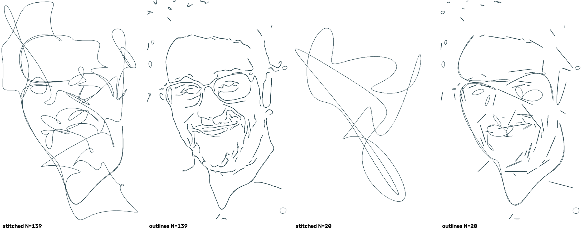

# Fourier portrait studio

Interactive **Next.js** experience: a student reconstructs a professor-shaped curve with **live Fourier epicycles** (sparse DFT, magnitude-sorted harmonics, canvas animation).

## Stack

- **Next.js 16** (App Router) · **TypeScript** · **Tailwind CSS v4**
- **Framer Motion** (scroll + hero motion)
- **React Three Fiber + Drei** (3D ribbon “wow” section, client-only dynamic import)
- **Canvas 2D** Fourier visualizer (`FourierVisualizer`)
- **Zustand** (`lib/store.ts`)
- **KaTeX** (math block)
- **Lenis** (smooth scroll)

## Run

```bash
npm install
npm run dev
```

Open [http://localhost:3000](http://localhost:3000).

## Separate outlines vs one stitched path

By default the sketch gives **every traced edge outline its own Fourier series** (the approach in
[DrawingWithFFT](https://github.com/cjcrowley/DrawingWithFFT)), instead of chaining all edges into one loop.
Stitching draws a jump line between every pair of features — about a quarter of the default portrait's path — and
spends terms on those jumps. Each outline is resampled at the same arc-length spacing, and the term slider sets the
longest outline's terms with shorter ones scaled down, so detail stays even across the drawing.
"Draw as → One stitched path" in the playground switches back.



## Desmos export

"Copy Desmos formula" produces **one LaTeX expression** that draws every curve: the terms are flattened
into `A` (amplitude), `F` (frequency), `P` (phase) lists and `O` (where each curve's terms start), and a list
comprehension draws one parametric curve per outline. Paste it into a single empty Desmos row. It uses
`2πt`, so Desmos' default `0 ≤ t ≤ 1` draws the whole curve. Coordinates are centred, scaled to the default
view and flipped upright. Code: [`lib/desmosFormula.ts`](lib/desmosFormula.ts).

## Tests

```bash
node --test tests/fourier.test.ts   # DFT / no zero-padding (Node ≥ 23)
python tests/test_outlines.py       # outline extraction (numpy + opencv)
```

## Legacy

The original static **single-file** studio (HTML + worker) is preserved under [`legacy/`](./legacy/) (not used by the Next app).

## Fonts

- **Space Grotesk** — headings  
- **Inter** — body  
- **JetBrains Mono** — math / asides  

## License

Private / educational — adjust as you like.
